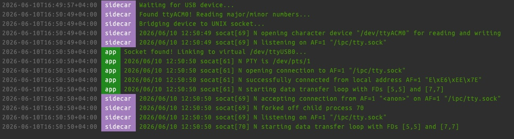
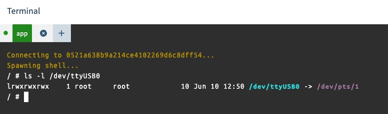

# USB Serial Access via Privileged Sidecar 

> [!WARNING]
> **This is a demo and proof-of-concept.** It is intended to showcase the pattern, not serve as production-ready code. Before deploying in a production environment, you should carefully review the security implications of the privileged sidecar, add robust error handling and reconnection logic, harden the socket permissions, and test thoroughly against your specific hardware and failure scenarios.

This repository demonstrates a pattern for accessing physical USB serial devices (such as FTDI chips, USB-to-RS485 adapters, or Zigbee dongles) inside a multi-container balenaOS application.

By splitting the hardware access across a two-container architecture, the container running your core application code (`app`) can remain **unprivileged**.

[](https://dashboard.balena-cloud.com/deploy?repoUrl=https://github.com/balena-solutions/usb-serial-pty-sidecar)

## The Approach

Instead of making your main application container fully privileged, this approach decouples **physical hardware access** from **application logic** using an internal `socat` pseudo-terminal (PTY) bridge.

### Architecture Diagram

```text
+-----------------------------------------------------------------------+
|                             balenaOS Host                             |
|                                                                       |
|   +--------------------------+                                        |
|   | Physical USB Hardware    | (USB Device)                           |
|   +-------------+------------+                                        |
|                 |                                                     |
|                 v (/dev/ttyACM0)                                      |
|   +--------------------------+                                        |
|   |  Sidecar Container       | (privileged: true)                     |
|   |  - Detects USB hardware  |                                        |
|   |  - Bridges to IPC socket |                                        |
|   +-------------+------------+                                        |
|                 |                                                     |
|                 v (unix socket stream)                                |
|         [ ipc-sockets volume ]                                        |
|                 |                                                     |
|                 v                                                     |
|   +--------------------------+                                        |
|   |  App Container           | (privileged: false)                    |
|   |  - Asynchronously waits  |                                        |
|   |  - Creates virtual PTY   |                                        |
|   |  - Exposes /dev/ttyUSB0  |                                        |
|   +--------------------------+                                        |
|                                                                       |
+-----------------------------------------------------------------------+
```

### How it works

1. The privileged `sidecar` runs a lightweight script that monitors sysfs for when a target USB device is plugged in. Once detected, it grabs the device's major/minor numbers, creates a local node, and opens a socat instance to stream the hardware interface over a shared UNIX socket file.

2. The unprivileged `app` container shares a named volume containing the UNIX socket. A background script asynchronously waits for the socket to appear, then leverages socat to bind that stream to a virtual pseudo-terminal port (`/dev/ttyUSB0`) entirely inside its own isolated filesystem.

3. Your application interacts with `/dev/ttyUSB0` exactly like a real physical serial port, requiring zero code modifications.

## Example using a Waveshare USB to RS485(B) device connected to a Raspberry Pi 




